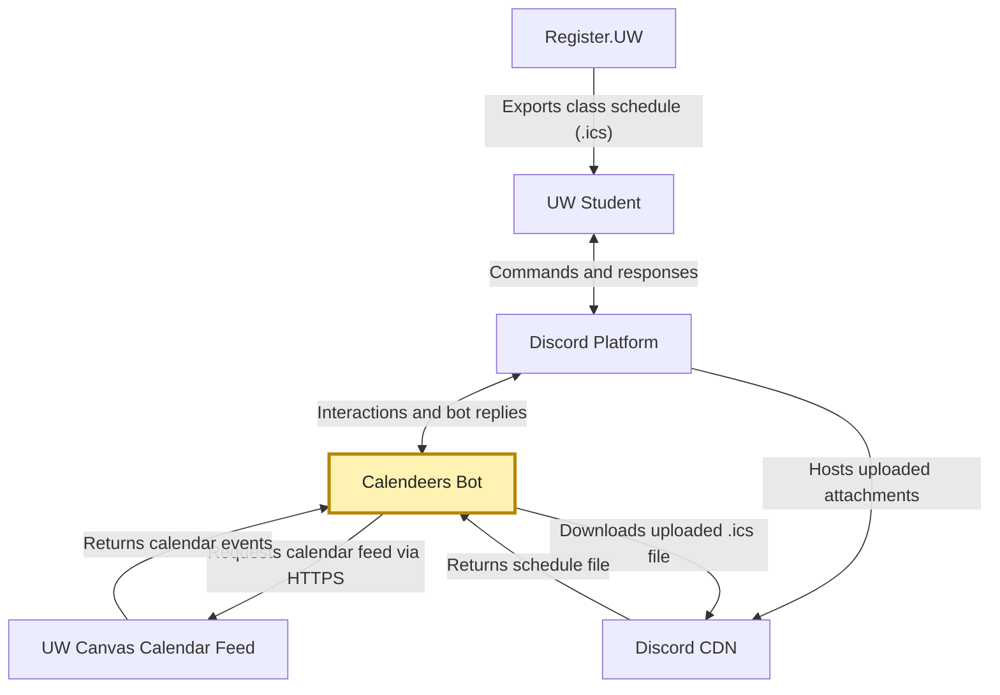

# Calendeers Architecture Documentation

## Data Flow Diagram: 

The data flow diagram shows how Calendeers transfers calendar and class-schedule information between the student, Discord, its internal services, and local storage. A student sends commands through Discord, which passes the interaction and Discord user ID to the command handler (`src/events/interactionCreate.js`). The handler coordinates the services responsible for fetching calendar events, importing class schedules as well as accessing saved data.

The diagram identifies three main data-processing paths:

1. **Canvas calendar:** The Canvas Feed Service (`src/services/canvasFeed.js`) uses the student's calendar feed URL to retrieve iCalendar (`.ics`) events from UW Canvas over HTTPS. It passes parsed calendar information back to the command handler.
2. **Register.UW class schedule:** The Class Schedule Service (`src/services/classSchedule.js`) processes an `.ics` schedule file uploaded by the student through Discord. The file is retrieved from Discord's content delivery network (CDN), parsed and then returned as class data. The bot does not request the schedule directly from Register.UW.
3. **Local calendar storage:** The Calendar Store (`src/services/calendarStore.js`) associates saved calendar information with the student's Discord user ID. It encrypts and saves the Canvas feed URL in `calendar-links.json` and class-schedule data in `class-schedules.json`, and retrieves or deletes this information when the appropriate command is called.

In this diagram, **rectangles** indicate outside actors or systems, **circles** indicate processing components inside Calendeers, and **cylinders** indicate local files used to store data. The arrows show information exchanged between these elements, including command responses to the student.

## Activity Diagram: 

The activity diagram illustrates the `/connect` workflow when a student supplies both a UW Canvas calendar feed URL and a Register.UW `.ics` schedule file. It emphasizes the order of actions, validation decisions, successful storage, and error handling.

The workflow is as follows:

1. **Start:** The student runs `/connect`, enters a Canvas calendar feed URL, and uploads a Register.UW `.ics` file.
2. **Validate the inputs:** Calendeers checks that a file was uploaded and that the Canvas URL is valid. If either check fails, the workflow follows the private-error path.
3. **Retrieve Canvas data:** The bot attempts to access and parse the Canvas calendar feed. An inaccessible or invalid feed leads to a private error.
4. **Import the class schedule:** The bot downloads the uploaded `.ics` file and parses its course information. If the schedule cannot be validated, the workflow ends with a private error.
5. **Save the connection:** If all checks succeed, Calendeers encrypts the feed URL and parsed class data and stores them under the student's Discord user ID.
6. **Confirm:** The bot sends the student a private success message and the activity ends.

The **green shapes** mark the beginning and end, **yellow rectangles** represent actions, **blue diamonds** show decisions, and the **orange rectangle** represents the error outcome. This diagram documents the path with both inputs; it does not attempt to model other possible forms of `/connect` invocation.

**Related implementation:** `src/events/interactionCreate.js`, `src/services/canvasFeed.js`, `src/services/classSchedule.js`, and `src/services/calendarStore.js`.

## Use Case Diagram: 

Add description and diagram here

## System Context Diagram: 

The system context diagram shows how Calendeers interacts with students and external systems. Calendeers is a Discord bot that helps UW students organize their Canvas assignments and Register.UW class schedules.

### External Systems and Interactions

1. **UW Student:** Students interact with Calendeers through Discord commands such as `/connect`, `/classes`, `/schedule`, and `/missing` to manage class schedules and assignments.

2. **Discord Platform:** Discord acts as the communication interface between students and the bot. It delivers commands and interactions to Calendeers and displays the bot's responses.

3. **UW Canvas Calendar Feed:** Calendeers retrieves calendar events and assignment information through a student's Canvas iCalendar feed URL using HTTPS.

4. **Register.UW:** Students export their class schedules as `.ics` files from Register.UW and upload them through Discord. Calendeers does not directly connect to Register.UW.

5. **Discord CDN:** Discord hosts uploaded schedule attachments. Calendeers downloads these files to process class schedule information.

### System Boundary

Calendeers is the central system in this diagram. It processes Discord interactions, retrieves calendar information, parses uploaded schedules, and manages locally saved user data. Its local JSON storage is considered an internal component rather than a separate external system.

This diagram focuses on the system's external relationships rather than its internal implementation.

## Network Diagram: 

Add description and diagram here

## Control-Flow Diagram: 

Add description and diagram here

## Class Diagram: 

Add description and diagram here
